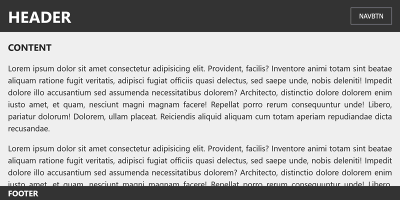
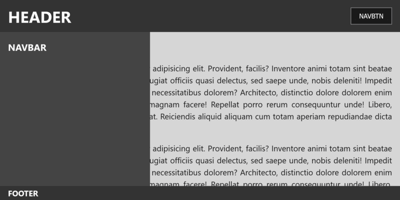
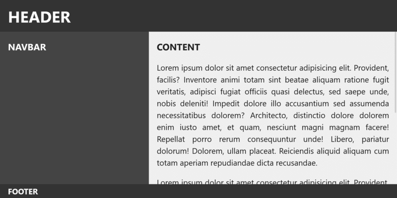
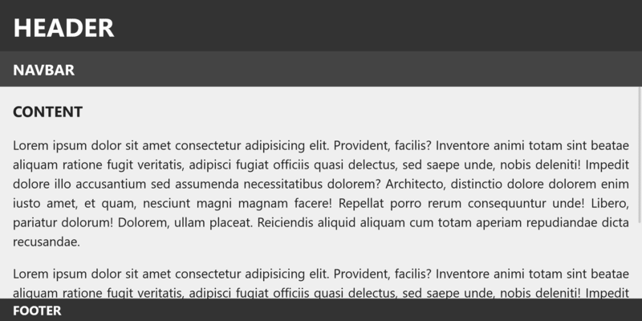

# `layout`

[](https://github.com/K3nguruh/layout)
[](https://github.com/K3nguruh/layout/issues)
[](https://github.com/K3nguruh/layout/blob/main/LICENSE)
[](https://github.com/K3nguruh/layout/stargazers)
[](https://github.com/K3nguruh/layout/network/members)

Das Plugin basiert auf der jQuery UI Widget Factory. Es verwaltet responsive Layout-Zustände und steuert die Sichtbarkeit sowie den Aktivitätsstatus von Navigation, Navigation-Button und Overlay über konfigurierbare CSS-Klassen. Dabei wird die aktuelle Fensterbreite überwacht, um automatisch zwischen einer responsiven Mobile-Ansicht mit aufklappbarer Navigation und einer festen Sidebar- oder Desktop-Darstellung umzuschalten.

## Funktionalitäten

- Automatische Initialisierung über das HTML5-Data-Attribut `data-plugin="layout"` sowie die Konfiguration über HTML5-Data-Attribute.
- Dynamische Wechsel zwischen der Mobile-, der Sidebar- und der Desktop-Ansicht basierend auf der Viewport-Breite und der Option `sidebar`.
- Performance-optimierte Verarbeitung von Ereignissen zur Fenstergrößenänderung über die `requestAnimationFrame`-API.
- Steuerung der Navigation in der Mobile-Ansicht inklusive des Klick-Handlings für den Navigation-Button und das Overlay.
- Bereitstellung öffentlicher Methoden (`open`, `close`, `toggle`) für den programmatischen Zugriff in der Mobile-Ansicht.

## Voraussetzungen

- jQuery `1.7+`
- jQuery UI `1.8+`; vorausgesetzt wird das Widget-Modul: `Core` → `Widget`
- Aktuelle Webbrowser mit ES6- und CSS3-Unterstützung

## Installation & Einbindung

### 1. Repository klonen

```sh
git clone https://github.com/K3nguruh/layout.git
```

### 2. Dateieinbindung

Trage die benötigten Scripte und Stylesheets in das HTML-Dokument ein:

```html
<!-- Externe Bibliotheken -->
<script src="path/to/jquery.min.js"></script>
<script src="path/to/jquery-ui.min.js"></script>

<!-- Plugin Dateien -->
<link href="path/to/layout.min.css" rel="stylesheet" />
<script src="path/to/layout.min.js"></script>
```

## Anwendung

### Layout-Ansichten

Das Layout wechselt automatisch zwischen drei verschiedenen Ansichten. Die Auswahl erfolgt anhand der aktuellen Viewport-Breite und der Option `sidebar`.

- **Mobile:** Die Viewport-Breite liegt unterhalb des definierten `breakpoint`.
- **Sidebar:** Die Viewport-Breite entspricht mindestens dem `breakpoint` und `sidebar` ist `true`.
- **Desktop:** Die Viewport-Breite entspricht mindestens dem `breakpoint` und `sidebar` ist `false`.

### Benötigte HTML-Struktur

Das Plugin benötigt ein Layout-Element sowie Elemente für Navigation, Navigation-Button und Overlay. Die Selektoren für diese Elemente können über die Optionen `navbtn`, `navbar` und `overlay` angepasst werden. Ansonsten werden keine festen CSS-Selektoren für Header, Main und Footer vorgeschrieben. Eine mögliche HTML-Struktur sieht beispielsweise wie folgt aus:

```html
<body id="layout">
  <div id="header">
    HEADER
    <button id="navbtn">NAVBTN</button>
  </div>
  <div id="navbar">NAVBAR</div>
  <div id="main">MAIN</div>
  <div id="footer">FOOTER</div>
  <div id="overlay"></div>
</body>
```

_Wird kein `overlay` benötigt, kann das Element aus dem HTML-Code entfernt werden._

### Automatische Initialisierung (über HTML)

Jedes Element mit dem Attribut `data-plugin="layout"` wird beim Laden der Seite automatisch als Plugin initialisiert. Optionen können direkt über `data-*`-Attribute übergeben werden:

```html
<!-- Mit Standardoptionen -->
<body id="layout" data-plugin="layout">
  <!-- ... -->
</body>

<!-- Mit Benutzerdefinierten Optionen -->
<body id="layout" data-plugin="layout" data-breakpoint="768" data-sidebar="true">
  <!-- ... -->
</body>
```

### Manuelle Initialisierung (über JavaScript)

Das Plugin kann alternativ direkt über JavaScript initialisiert werden:

```javascript
// Mit Standardoptionen
$(function () {
  $("#layout").layout();
});

// Mit Benutzerdefinierten Optionen
$(function () {
  $("#layout").layout({
    breakpoint: 768,
    sidebar: true,
  });
});
```

### Laufzeitsteuerung & Methodenaufrufe

```javascript
// Aktuelle Werte auslesen
const breakpoint = $("#layout").layout("option", "breakpoint");
const isSidebar = $("#layout").layout("option", "sidebar");

// Breakpoint zur Laufzeit ändern
$("#layout").layout("option", "breakpoint", 768);

// Sidebar-Ansicht zur Laufzeit aktivieren / deaktivieren
$("#layout").layout("option", "sidebar", true);
$("#layout").layout("option", "sidebar", false);

// Navigation manuell öffnen / schließen / umschalten
$("#layout").layout("open");
$("#layout").layout("close");
$("#layout").layout("toggle");

// Plugin zerstören und Zustand zurücksetzen
$("#layout").layout("destroy");
```

_Die Methoden `open`, `close` und `toggle` haben nur in der Mobile-Ansicht eine Wirkung._

## Live-Demo

### Funktionen der Demo-Seite

- **Breakpoint:** Über ein Eingabefeld kann der `breakpoint` (Standard: `1200`) zur Laufzeit angepasst werden, um das Verhalten bei unterschiedlichen Bildschirmgrößen zu testen.
- **Sidebar:** Über den Button **"Sidebar ändern"** lässt sich die Sidebar-Ansicht aktivieren / deaktivieren.
- **Navigation:** Über weitere Buttons lassen sich die Plugin-Methoden `open`, `close` und `toggle` direkt testen.

### [Hier direkt die Live-Demo ausprobieren](https://K3nguruh.github.io/layout/#live-demo)

Die Live-Demo befindet sich im Repository unter [docs/index.html](docs/index.html) und kann nach dem Download / Klonen direkt im Browser oder über einen lokalen Webserver (z. B. XAMPP) geöffnet werden.

## API-Dokumentation

### Optionen

| Option           | Typ       | Standardwert  | Beschreibung                                                                  |
| ---------------- | --------- | ------------- | ----------------------------------------------------------------------------- |
| **`breakpoint`** | `number`  | `1200`        | Viewport-Breite in Pixeln, unterhalb derer die Mobile-Ansicht aktiviert wird. |
| **`sidebar`**    | `boolean` | `false`       | Aktiviert ab dem Breakpoint die Sidebar-Ansicht anstatt der Desktop-Ansicht.  |
| **`navbtn`**     | `string`  | `"#navbtn"`   | CSS-Selektor für das Navigation-Button-Element.                               |
| **`navbar`**     | `string`  | `"#navbar"`   | CSS-Selektor für das Navigation-Element.                                      |
| **`overlay`**    | `string`  | `"#overlay"`  | CSS-Selektor für das Overlay-Element.                                         |
| **`classes`**    | `object`  | _Siehe unten_ | Objekt zur Definition der verwendeten CSS-Klassennamen.                       |

### CSS-Klassen-Konfiguration (`classes`)

| Eigenschaft          | Typ      | Standardwert       | Beschreibung                                                             |
| -------------------- | -------- | ------------------ | ------------------------------------------------------------------------ |
| **`layout`**         | `string` | `"layout"`         | Basis-Klasse für das Layout-Element.                                     |
| **`layoutMobile`**   | `string` | `"layout-mobile"`  | Wird in der Mobile-Ansicht dem Layout-Element zugewiesen.                |
| **`layoutSidebar`**  | `string` | `"layout-sidebar"` | Wird in der Sidebar-Ansicht dem Layout-Element zugewiesen.               |
| **`layoutDesktop`**  | `string` | `"layout-desktop"` | Wird in der Desktop-Ansicht dem Layout-Element zugewiesen.               |
| **`stateAnimated`**  | `string` | `"is-animated"`    | Wird für die CSS-Übergänge dem Layout-Element zugewiesen.                |
| **`stateCollapsed`** | `string` | `"is-collapsed"`   | Wird bei geschlossener Navigation dem Layout-Element zugewiesen.         |
| **`stateExpanded`**  | `string` | `"is-expanded"`    | Wird bei geöffneter Navigation dem Layout-Element zugewiesen.            |
| **`stateActive`**    | `string` | `"active"`         | Wird bei geöffneter Navigation dem Navigation-Button-Element zugewiesen. |

Die CSS-Klassennamen können individuell angepasst werden:

```javascript
$("#layout").layout({
  classes: {
    layout: "my-layout",
    layoutMobile: "my-layout-mobile",
    layoutSidebar: "my-layout-sidebar",
    layoutDesktop: "my-layout-desktop",
    stateAnimated: "my-is-animated",
    stateCollapsed: "my-is-collapsed",
    stateExpanded: "my-is-expanded",
    stateActive: "my-active",
  },
});
```

_Die entsprechenden CSS-Selektoren müssen bei Verwendung eigener CSS-Klassennamen ebenfalls angepasst werden._

### Öffentliche Methoden

| Methode       | Aufruf                           | Parameter         | Beschreibung                                                              |
| ------------- | -------------------------------- | ----------------- | ------------------------------------------------------------------------- |
| **`option`**  | `layout("option", key, [value])` | `string`, `[any]` | Liest oder setzt die Optionen `breakpoint` und `sidebar` zur Laufzeit.    |
| **`open`**    | `layout("open")`                 | _keine_           | Öffnet die Navigation in der Mobile-Ansicht, sofern sie geschlossen ist.  |
| **`close`**   | `layout("close")`                | _keine_           | Schließt die Navigation in der Mobile-Ansicht, sofern sie geöffnet ist.   |
| **`toggle`**  | `layout("toggle")`               | _keine_           | Öffnet / Schließt die Navigation in der Mobile-Ansicht.                   |
| **`destroy`** | `layout("destroy")`              | _keine_           | Zerstört das Plugin und stellt den ursprünglichen DOM-Zustand wieder her. |

## Beispiel-Ansichten


<br>_Mobile-Ansicht mit geschlossener Navigation_


<br>_Mobile-Ansicht mit geöffneter Navigation_


<br>_Sidebar-Ansicht_


<br>_Desktop-Ansicht_

## Support

Fehler, Verbesserungsvorschläge und Fragen können über den [GitHub Issue Tracker](https://github.com/K3nguruh/layout/issues) eingereicht werden.

## Lizenz

Dieses Projekt steht unter der [MIT License](https://github.com/K3nguruh/layout/blob/main/LICENSE).
